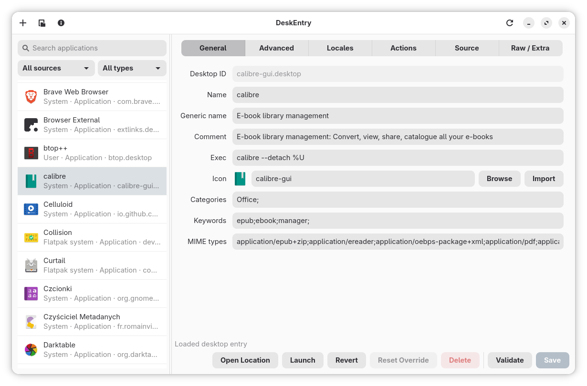
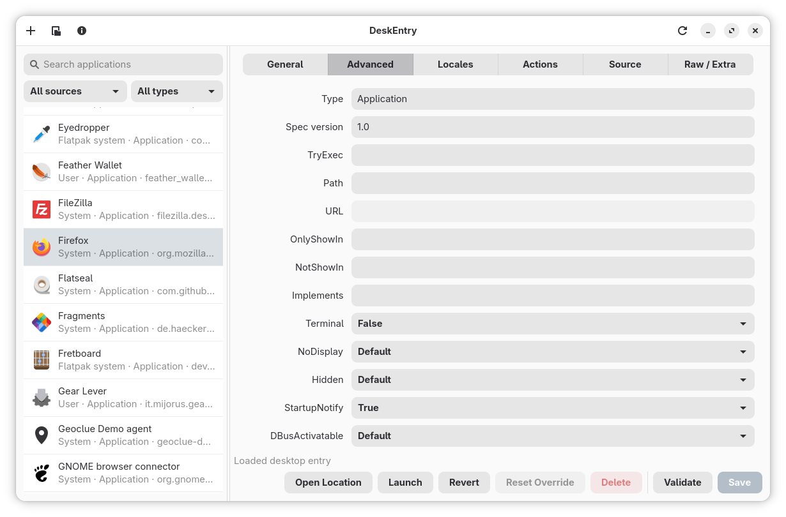

# DeskEntry

DeskEntry is a GNOME-first manager for Linux `.desktop` files. It discovers desktop entries from XDG data directories, Flatpak and Snap, and lets you customize them safely through user overrides instead of modifying package-managed files.

## Screenshots

### General editor



### Advanced editor



## Features

- Discover desktop entries from XDG, Flatpak, Snap and custom XDG data directories
- Search and filter entries by source and desktop entry type
- Edit standard Desktop Entry fields, optional booleans and localized values
- Create and edit Desktop Actions with localized names and icons
- Browse icons from the active GTK icon theme and import SVG or compatible PNG icons into the user `hicolor` theme
- Open external `.desktop` files and import them as user entries
- Compare a user override with the current original system, Flatpak, Snap or XDG entry
- View the original source and selectively apply individual original values to an override
- Preview the resulting raw source and edit extra or vendor-specific keys
- Adapt the editor to `Application`, `Link` and `Directory` entry types
- Preserve comments, unknown keys and unmanaged groups while editing
- Create user overrides without modifying package-managed files
- Reset overrides and safely delete user-owned entries with confirmation
- Validate entries with `desktop-file-validate`
- Use atomic writes and backups for user entries
- Protect unsaved changes when switching entries, reloading, opening files or closing the application
- Launch entries and open their file location
- Show application information, version, author and project link in the About dialog
- Work locally without network access, telemetry or privileged writes

## Usage

Select a desktop entry from the sidebar, edit its fields and choose **Save**. Changes to system, Flatpak, Snap or other package-managed entries are written as a user override in `$XDG_DATA_HOME/applications`.

Use **Reset Override** to remove a user override and restore the next entry in XDG precedence order. **Delete** is available only for user-owned entries. The **Source** page shows the current original behind an override and lets you review or selectively reuse its values.

Keyboard shortcuts:

- `Ctrl+S` — Save
- `Ctrl+N` — New entry
- `Ctrl+O` — Open `.desktop` file
- `Ctrl+R` — Reload entries
- `Ctrl+F` — Search

## Install

## Download

A prebuilt x86_64 Linux binary is available from GitHub Releases:

https://github.com/h0ek/deskentry/releases

Make it executable and run it:

```bash
chmod +x deskentry-VERSION-x86_64
./deskentry-VERSION-x86_64
```

To install it for the current user:
```bash
install -Dm755 deskentry-VERSION-x86_64 "$HOME/.local/bin/deskentry"
```

### Build from source

Requirements:

- Rust 1.94.1 or newer
- GTK 4.10 or newer
- libadwaita 1.5 or newer
- `desktop-file-utils`
- `glib-compile-resources`

On Fedora:

```bash
sudo dnf install gtk4-devel libadwaita-devel desktop-file-utils glib2-devel gcc git
git clone https://github.com/h0ek/deskentry.git
cd deskentry
cargo build --release
```

If you want to add the compiled application to your user session menu, install the binary, desktop entry and icons:

```bash
install -Dm755 target/release/deskentry "$HOME/.local/bin/deskentry"
install -Dm644 data/io.github.h0ek.DeskEntry.desktop "$HOME/.local/share/applications/io.github.h0ek.DeskEntry.desktop"
install -Dm644 data/icons/hicolor/48x48/apps/io.github.h0ek.DeskEntry.png "$HOME/.local/share/icons/hicolor/48x48/apps/io.github.h0ek.DeskEntry.png"
install -Dm644 data/icons/hicolor/96x96/apps/io.github.h0ek.DeskEntry.png "$HOME/.local/share/icons/hicolor/96x96/apps/io.github.h0ek.DeskEntry.png"
```

DeskEntry can then be launched from the GNOME application menu or from a terminal with:

```bash
deskentry
```

## License

MIT
